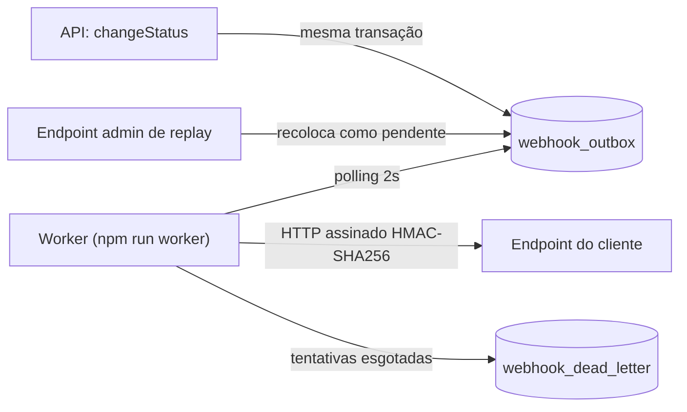

### FDD: Webhooks de notificação de mudança de status de pedidos

Versão: 0.1 (rascunho para revisão técnica antes do início da implementação)
Data: 2026-11-04
Responsável: Larissa (Tech Lead)

Documentos de referência: [RFC](RFC.md) e [ADR-001 a ADR-008](adrs/). Rastreabilidade de cada item em [TRACKER.md](TRACKER.md) (IDs `FDD-*`).

---

### 1. Contexto e motivação técnica

**Problema técnico.** Hoje a plataforma não emite eventos: os clientes B2B (Atlas Comercial, MaxDistribuição e Nova Cargo) consultam `GET /orders` periodicamente, o que torna a integração lenta e cara. Eles precisam ser notificados de mudanças de status em menos de 10 segundos, limite que consideram "tempo real". Não existe módulo de webhooks no código; os módulos atuais são `auth`, `customers`, `orders`, `products` e `users` (`src/modules/`).

A mudança de status ocorre em `OrderService.changeStatus` (`src/modules/orders/order.service.ts`), dentro de um único `prisma.$transaction` que valida a transição (`canTransition` em `src/modules/orders/order.status.ts`), debita estoque em PENDING para PAID, repõe estoque no cancelamento a partir de PAID ou PROCESSING, atualiza `orders` e insere em `order_status_history`. Uma chamada HTTP nessa transação faria um cliente lento travar mudanças de status de outros pedidos e não permitiria reverter a mudança quando o cliente estivesse fora do ar. A solução decidida desacopla a entrega usando outbox no MySQL e worker separado (RFC, seção 3; ADR-001).

**Encaixe na arquitetura (RFC, seção 3).**



**Atores**
- Clientes B2B: recebem os webhooks em endpoints HTTPS próprios.
- Usuários autenticados com JWT do sistema que representam o cliente: cadastram e gerenciam webhooks pela API da plataforma, com qualquer role autenticada.
- Usuário com role ADMIN: executa o replay de eventos da DLQ.
- Worker de webhooks: processo Node separado que lê a outbox e faz as entregas (ADR-003).

**Limites**
- Apenas webhooks de saída, da plataforma para os clientes.
- Ordem de entrega garantida apenas por `order_id` e enquanto houver um único worker; não há ordenação global.

---

### 2. Objetivos técnicos

- Entregar o evento ao cliente em menos de 10 segundos após a mudança de status, com latência de polling de até 2 segundos aceita como inerente à solução (ADR-002).
- Invariante de atomicidade: toda mudança de status que gere evento commita junto com a linha na `webhook_outbox`; se a inserção falhar, a mudança de status sofre rollback (ADR-001).
- Garantia at-least-once, com `X-Event-Id` (UUID gerado na entrada da outbox) único por evento para deduplicação no cliente (ADR-007).
- Toda entrega assinada com HMAC-SHA256 sobre o corpo do request, com secret única por endpoint (ADR-006).
- Todo evento termina em entrega ou em falha permanente registrada na `webhook_dead_letter`, após 5 tentativas com backoff de 1m, 5m, 30m, 2h e 12h (ADR-004; ADR-005).
- Timeout de 10 segundos por chamada HTTP do worker.
- Payload limitado a 64KB, com erro se ultrapassado.
- Reuso dos padrões existentes sem alteração do middleware de erro: `AppError`, Pino, `errorMiddleware`, padrão de módulos e schemas Zod, códigos de erro com prefixo `WEBHOOK_`.

---

### 3. Escopo e exclusões

**Incluído**
- Tabela `webhook_outbox` com id UUID, payload renderizado na inserção, status pendente, processando, falhou e entregue, e índices em status e `created_at` (ADR-001; ADR-008).
- Função `publishWebhookEvent(tx, order, fromStatus, toStatus)`, chamada por `changeStatus` com o client da transação corrente.
- Filtro por lista de status aplicado na inserção da outbox: se nenhum webhook do customer quer aquele status, nada é inserido.
- Configuração de webhook com url, secret, `customer_id`, estado ativo e lista de status.
- CRUD de configuração (`POST`, `GET`, `PATCH`, `DELETE`) para qualquer role autenticada.
- Endpoint de rotação de secret, com grace period de 24 horas para a secret antiga.
- Endpoint `GET /webhooks/:id/deliveries` com o histórico de entregas.
- Worker em processo separado (`src/worker.ts`, `npm run worker`), com polling de 2 segundos e lógica de processamento em arquivo do módulo, como `src/modules/webhooks/webhook.worker.ts` ou `webhook.processor.ts` (ADR-002; ADR-003).
- Retry com backoff exponencial, `webhook_dead_letter` com payload, motivo da falha e timestamp, e replay manual por `POST /admin/webhooks/dead-letter/:id/replay` com role ADMIN (ADR-004; ADR-005).
- Validação de URL `https` no schema Zod e limite de payload de 64KB.

**Excluído**
- Webhooks de entrada (clientes enviando para a plataforma).
- Notificação por email ao cliente quando o webhook falha, inclusive como fallback: próxima fase.
- Dashboard visual para o cliente: projeto separado do time de frontend.
- Arquivamento de linhas entregues da outbox.
- Garantia exactly-once (ADR-007).

---

### 4. Fluxos detalhados e diagramas

**Fluxo principal**
1. Um usuário autenticado chama `PATCH /api/v1/orders/:id/status`; `OrderController.changeStatus` delega a `OrderService.changeStatus` (`src/modules/orders/order.controller.ts`, `src/modules/orders/order.routes.ts`).
2. Dentro do `prisma.$transaction`, o fluxo atual valida a transição, movimenta estoque, atualiza `orders` e insere em `order_status_history` (`src/modules/orders/order.service.ts`).
3. Na mesma transação, `changeStatus` chama `publishWebhookEvent(tx, order, fromStatus, toStatus)`. Se algum webhook do customer inclui `toStatus` na lista de status, a função insere o evento na `webhook_outbox` com status pendente, `event_id` UUID e payload já renderizado.
4. A transação commita; status, histórico, estoque e evento ficam persistidos juntos.
5. A cada 2 segundos, o worker busca em batch pequeno os eventos pendentes mais antigos, em ordem de `created_at`.
6. O worker assina o corpo com HMAC-SHA256 usando a secret do endpoint e faz o `POST` para a url cadastrada com os headers `Content-Type`, `X-Event-Id`, `X-Signature`, `X-Timestamp` e `X-Webhook-Id`, com timeout de 10 segundos.
7. Em caso de sucesso, o evento é marcado como entregue.

**Fluxos alternativos e exceções**
- Nenhum webhook do customer escuta `toStatus`: nada é inserido na outbox e a mudança de status segue normalmente.
- Falha na inserção da outbox: a exceção propaga para fora do `$transaction`, todo o `changeStatus` sofre rollback e o erro chega ao `errorMiddleware` via `next(err)` (`src/modules/orders/order.controller.ts`, `src/middlewares/error.middleware.ts`).
- Cliente lento (sem resposta em 10 segundos) ou indisponível: a entrega é tratada como falha e marcada para retry.
- Retry: novas tentativas após 1m, 5m, 30m, 2h e 12h, cobrindo quase 15 horas entre a primeira falha e a última tentativa (ADR-004).
- Tentativas esgotadas: falha permanente; o evento vai para a `webhook_dead_letter` com payload, motivo da falha e timestamp (ADR-005).
- Replay: um ADMIN chama `POST /admin/webhooks/dead-letter/:id/replay`, o evento volta para a outbox como pendente e o replay é registrado em log com o autor, para auditoria.
- Payload acima de 64KB: o evento não é enviado e é gerado erro.
- Rotação de secret: o cliente pede nova secret pela API; a antiga permanece válida por 24 horas em paralelo e depois deixa de valer.
- Entrega duplicada: possível pela garantia at-least-once; o cliente deduplica por `X-Event-Id`.

**Diagramas** (opcional)

```mermaid
sequenceDiagram
    participant U as Usuário autenticado
    participant API as API (OrderService.changeStatus)
    participant DB as MySQL
    participant W as Worker (npm run worker)
    participant C as Endpoint do cliente

    U->>API: PATCH /api/v1/orders/:id/status
    API->>DB: BEGIN; update orders; insert order_status_history
    API->>DB: publishWebhookEvent(tx, ...): insert webhook_outbox (pendente)
    API->>DB: COMMIT
    API-->>U: 200 (order atualizada)
    loop a cada 2 segundos
        W->>DB: busca pendentes mais antigos (batch pequeno)
    end
    W->>C: POST url (X-Event-Id, X-Signature, X-Timestamp, X-Webhook-Id), timeout 10s
    alt sucesso
        W->>DB: marca evento como entregue
    else falha ou timeout
        W->>DB: agenda retry (1m, 5m, 30m, 2h, 12h)
    else tentativas esgotadas
        W->>DB: insert webhook_dead_letter (payload, motivo, timestamp)
    end
```

---

### 5. Contratos públicos (assinaturas, endpoints, headers, exemplos)

Convenções aplicadas a todos os endpoints da API de gestão:
- Rotas montadas sob `/api/v1`, como todos os routers atuais (`src/routes/index.ts`).
- Autenticação com `Authorization: Bearer <JWT>` via `authenticate` (`src/middlewares/auth.middleware.ts`); ausência ou invalidez do token retorna `401 UNAUTHORIZED`.
- Validação com `validate({ body, query, params })` e schemas Zod (`src/middlewares/validate.middleware.ts`).
- Erros no envelope `{ "error": { "code", "message", "details?" } }` (`src/middlewares/error.middleware.ts`).
- Status de sucesso seguem os controllers existentes: `201` na criação, `200` em leitura e alteração, `204` na remoção (`src/modules/orders/order.controller.ts`).
- Campos da API de gestão em camelCase, como nos schemas atuais (`src/modules/orders/order.schemas.ts`).

**Contrato 1: publicação de evento na outbox**
- Tipo: function
- Assinatura/Rota: `publishWebhookEvent(tx, order, fromStatus, toStatus)`
- Método: chamada interna dentro do `prisma.$transaction` de `changeStatus`
- Semântica de status/headers:
  - `tx`: `Prisma.TransactionClient` da transação corrente (tipo `TxClient` em `src/modules/orders/order.service.ts`); a função não abre transação própria.
  - Exceção lançada: propaga e provoca rollback da mudança de status.
  - Nenhum webhook interessado em `toStatus`: retorna sem inserir.

**Contrato 2: cadastrar webhook**
- Tipo: endpoint
- Assinatura/Rota: `POST /api/v1/webhooks`
- Método: POST
- Semântica de status/headers:
  - `201`: webhook criado; a secret é gerada pela plataforma e devolvida nesta resposta.
  - `400`: url fora de `https` ou corpo inválido.
  - `401 UNAUTHORIZED`: JWT ausente ou inválido.

**Exemplo de requisição**

```json
{
  "url": "https://erp.atlas.example/webhooks/orders",
  "statuses": ["SHIPPED", "DELIVERED"]
}
```

**Exemplo de resposta**

```json
{
  "id": "8e2f6a7b-1c3d-4e5f-9a0b-1c2d3e4f5a6b",
  "customerId": "5b0c1c9e-2f43-4c1a-9a43-0f1d6c0b7a11",
  "url": "https://erp.atlas.example/webhooks/orders",
  "statuses": ["SHIPPED", "DELIVERED"],
  "active": true,
  "secret": "<secret gerada pela plataforma>"
}
```

**Contrato 3: listar webhooks de um customer**
- Tipo: endpoint
- Assinatura/Rota: `GET /api/v1/webhooks`
- Método: GET
- Semântica de status/headers:
  - `200`: lista dos webhooks do customer.
  - `401 UNAUTHORIZED`: JWT ausente ou inválido.

**Exemplo de requisição**

```json
{}
```

**Exemplo de resposta**

```json
[
  {
    "id": "8e2f6a7b-1c3d-4e5f-9a0b-1c2d3e4f5a6b",
    "customerId": "5b0c1c9e-2f43-4c1a-9a43-0f1d6c0b7a11",
    "url": "https://erp.atlas.example/webhooks/orders",
    "statuses": ["SHIPPED", "DELIVERED"],
    "active": true
  }
]
```

**Contrato 4: editar webhook**
- Tipo: endpoint
- Assinatura/Rota: `PATCH /api/v1/webhooks/:id`
- Método: PATCH
- Semântica de status/headers:
  - `200`: webhook atualizado.
  - `400`: url fora de `https` ou corpo inválido.
  - `401 UNAUTHORIZED`: JWT ausente ou inválido.
  - `404 WEBHOOK_NOT_FOUND`: webhook inexistente.

**Exemplo de requisição**

```json
{
  "statuses": ["PAID", "SHIPPED", "DELIVERED"],
  "active": false
}
```

**Exemplo de resposta**

```json
{
  "id": "8e2f6a7b-1c3d-4e5f-9a0b-1c2d3e4f5a6b",
  "customerId": "5b0c1c9e-2f43-4c1a-9a43-0f1d6c0b7a11",
  "url": "https://erp.atlas.example/webhooks/orders",
  "statuses": ["PAID", "SHIPPED", "DELIVERED"],
  "active": false
}
```

**Contrato 5: remover webhook**
- Tipo: endpoint
- Assinatura/Rota: `DELETE /api/v1/webhooks/:id`
- Método: DELETE
- Semântica de status/headers:
  - `204`: webhook removido, sem corpo.
  - `401 UNAUTHORIZED`: JWT ausente ou inválido.
  - `404 WEBHOOK_NOT_FOUND`: webhook inexistente.

**Exemplo de requisição**

```json
{}
```

**Exemplo de resposta**

```json
{
  "error": {
    "code": "WEBHOOK_NOT_FOUND",
    "message": "Webhook not found"
  }
}
```

(Resposta de erro `404`; o sucesso `204` não tem corpo.)

**Contrato 6: histórico de entregas**
- Tipo: endpoint
- Assinatura/Rota: `GET /api/v1/webhooks/:id/deliveries`
- Método: GET
- Semântica de status/headers:
  - `200`: últimas entregas do webhook (referência de "os últimos 100"), com sucesso ou falha, payload, response e tempo de resposta.
  - `401 UNAUTHORIZED`: JWT ausente ou inválido.
  - `404 WEBHOOK_NOT_FOUND`: webhook inexistente.

**Exemplo de requisição**

```json
{}
```

**Exemplo de resposta**

```json
[
  {
    "eventId": "3f1e2d4c-5b6a-4789-8a9b-0c1d2e3f4a5b",
    "success": false,
    "payload": {
      "event_id": "3f1e2d4c-5b6a-4789-8a9b-0c1d2e3f4a5b",
      "event_type": "order.status_changed",
      "to_status": "SHIPPED"
    },
    "response": null,
    "responseTimeMs": 10000
  }
]
```

**Contrato 7: replay de evento da DLQ**
- Tipo: endpoint
- Assinatura/Rota: `POST /api/v1/admin/webhooks/dead-letter/:id/replay`
- Método: POST
- Semântica de status/headers:
  - `200`: evento recolocado na outbox como pendente; o replay é logado com o id do usuário que o executou.
  - `401 UNAUTHORIZED`: JWT ausente ou inválido.
  - `403 FORBIDDEN`: usuário sem role ADMIN, via `requireRole('ADMIN')` (`src/middlewares/auth.middleware.ts`).

**Contrato 8: entrega do webhook ao cliente**
- Tipo: endpoint (do cliente, chamado pelo worker)
- Assinatura/Rota: url `https` cadastrada pelo cliente
- Método: POST
- Semântica de status/headers:
  - `Content-Type: application/json`.
  - `X-Event-Id`: UUID do evento, gerado na entrada da outbox e único por evento; chave de deduplicação no cliente.
  - `X-Signature`: HMAC-SHA256 do corpo do request com a secret do endpoint.
  - `X-Timestamp`: timestamp do envio, para o cliente poder detectar replay attack.
  - `X-Webhook-Id`: id da configuração de webhook, para o cliente com vários cadastros identificar a origem.
  - Sem resposta em 10 segundos: falha, marcada para retry.
  - Corpo limitado a 64KB.

**Exemplo de requisição**

```json
{
  "event_id": "3f1e2d4c-5b6a-4789-8a9b-0c1d2e3f4a5b",
  "event_type": "order.status_changed",
  "timestamp": "2026-11-04T12:00:00.000Z",
  "order_id": "a1b2c3d4-e5f6-4a7b-8c9d-0e1f2a3b4c5d",
  "order_number": "ORD-000123",
  "from_status": "PROCESSING",
  "to_status": "SHIPPED",
  "customer_id": "5b0c1c9e-2f43-4c1a-9a43-0f1d6c0b7a11",
  "total_cents": 15990
}
```

Os itens do pedido não são enviados, e o cliente consulta `GET /orders/:id` se precisar de detalhes. O payload é renderizado na inserção da outbox (ADR-008). O formato `ORD-000123` vem de `reserveOrderNumber` (`src/modules/orders/order.service.ts`) e os valores de status, do enum `OrderStatus` (`prisma/schema.prisma`).

---

### 6. Erros, exceções e fallback

**Matriz de erros previstos e tratamentos**

Os códigos do módulo usam o prefixo `WEBHOOK_`. A coluna Rastreio aponta o ID correspondente em [TRACKER.md](TRACKER.md).

| Situação | Código | HTTP | Tratamento | Rastreio |
| --- | --- | --- | --- | --- |
| Webhook inexistente em `PATCH`, `DELETE`, rotação ou `GET /webhooks/:id/deliveries` | `WEBHOOK_NOT_FOUND` | 404 | Lançado pelo service; mapeado pelo `errorMiddleware` | FDD-ERRO-01 |
| Cadastro ou edição com url não `https` | `WEBHOOK_INVALID_URL` | 400 | Requisição recusada na validação | FDD-ERRO-01 |
| Replay sem role ADMIN | `FORBIDDEN` (existente) | 403 | `requireRole('ADMIN')` | FDD-ERRO-07 |
| Erro na inserção da outbox dentro de `changeStatus` | `INTERNAL_SERVER_ERROR` (existente, se não for `AppError` nem Prisma P2002/P2025) | 500 | Rollback de toda a mudança de status | FDD-ERRO-05 |
| Payload acima de 64KB | não se aplica | não se aplica | O evento não é enviado e é gerado erro | FDD-OBJ-03 |
| Cliente sem resposta em 10 segundos | não se aplica (worker) | não se aplica | Falha da tentativa, marcada para retry | FDD-OBJ-02 |
| Cliente indisponível ou com falha na entrega | não se aplica (worker) | não se aplica | Falha da tentativa; nova tentativa conforme o backoff | FDD-RES-01 |
| Tentativas esgotadas | não se aplica (worker) | não se aplica | Falha permanente; evento movido para `webhook_dead_letter` com payload, motivo da falha e timestamp | FDD-RES-02 |

**Integração do tratamento de erros com o código existente**
- `src/shared/errors/app-error.ts`: as classes `WEBHOOK_*` estendem `AppError` (`statusCode`, `errorCode`, `details`).
- `src/shared/errors/http-errors.ts`: o padrão a seguir é o de `InvalidStatusTransitionError` e `InsufficientStockError`, subclasses que fixam o código. `NotFoundError` fixa o código `NOT_FOUND` e não aceita código customizado, então `WEBHOOK_NOT_FOUND` precisa estender `AppError` diretamente com status 404.
- `src/middlewares/error.middleware.ts`: não muda. Qualquer `AppError` vira `{ error: { code, message, details? } }` com o `statusCode` da classe; erros fora de `AppError`, `ZodError` e Prisma P2002/P2025 viram `500 INTERNAL_SERVER_ERROR` e são logados como `Unhandled error in request`.
- `src/middlewares/validate.middleware.ts`: converte `ZodError` em `ValidationError` (`400`, `details` com `path` e `message`).
- `src/middlewares/auth.middleware.ts`: `authenticate` gera `401 UNAUTHORIZED` e `requireRole('ADMIN')` gera `403 FORBIDDEN` no replay.
- `src/modules/orders/order.service.ts`: erro lançado por `publishWebhookEvent` dentro do callback de `this.prisma.$transaction` desfaz a transação, e `OrderController.changeStatus` repassa o erro com `next(err)` (`src/modules/orders/order.controller.ts`).

**Estratégias de resiliência**
- Timeout: 10 segundos por chamada HTTP do worker.
- Retries: 5 tentativas com backoff exponencial de 1m, 5m, 30m, 2h e 12h (ADR-004).
- Desacoplamento: a chamada HTTP sai da transação de `changeStatus`; a disponibilidade do cliente não afeta a mudança de status.
- Isolamento de processo: o worker roda separado da API, e um reinício da API não o derruba (ADR-003).
- Leitura controlada: só pendentes, em batch pequeno, com índices em status e `created_at`.

**Política de fallback**
- Falha permanente leva o evento para a `webhook_dead_letter`, preservando payload, motivo da falha e timestamp como evidência (ADR-005).
- Recuperação por replay manual de um ADMIN, que recoloca o evento na outbox como pendente.
- Email como fallback fica para a próxima fase.

**Invariantes**
- Não existe mudança de status commitada sem o evento correspondente na outbox quando há webhook interessado.
- Rollback da mudança de status remove o evento junto.
- `event_id` é UUID gerado na entrada da outbox e único por evento; o id da outbox é UUID.
- O payload na outbox é o snapshot do momento da mudança de status (ADR-008).
- Só são enfileirados eventos cujo status está na lista do webhook.
- URL de webhook é sempre `https`.
- Cada endpoint tem secret única; nunca há secret global.
- Payload enviado nunca passa de 64KB.
- Com um único worker, eventos do mesmo `order_id` são processados em ordem de `created_at`.

---

### 7. Observabilidade

**Métricas**

- Tempo de resposta e resultado (sucesso ou falha) por entrega, registrados para o histórico de entregas.
- Eventos por status na `webhook_outbox` (pendente, processando, falhou, entregue), com índice em status.
- Registros na `webhook_dead_letter`, com motivo da falha.

**Logs**

- Pino, já usado no projeto, sem ferramenta nova (`src/shared/logger/index.ts`).
- Formato do logger atual: JSON com timestamp ISO, `base` com `service` e `env`, redaction de `authorization`, `cookie`, `password`, `passwordHash`, `token` e `accessToken`, e mensagens de evento em snake_case como `server_started` (`src/shared/logger/index.ts`, `src/server.ts`).
- Requests HTTP da API já são logados como `http_request` com `requestId`, `method`, `path`, `statusCode`, `durationMs` e `userId` (`src/middlewares/request-logger.middleware.ts`).
- Campos essenciais do módulo: id do usuário que executou o replay da DLQ, para auditoria; `event_id` e id do webhook como identificadores do evento e do cadastro.

**Tracing**

- Correlação pelo `requestId` gerado ou propagado via `X-Request-Id` na API (`src/middlewares/request-logger.middleware.ts`) e pelo `X-Event-Id` de ponta a ponta entre outbox, worker e cliente.

**Dashboards e alertas**

- O dashboard visual para o cliente está fora do escopo, e o aviso por email ao cliente sobre falhas fica para a próxima fase.

---

### 8. Dependências e compatibilidade

| Componente | Versão mínima | Observações |
| --- | --- | --- |
| Node.js | 20 | `engines.node >=20` em `package.json`; worker usa a mesma stack da API |
| MySQL | 8.0 | Imagem `mysql:8.0` em `docker-compose.yml`; sem listener nativo, por isso polling (ADR-002) |
| Prisma (`@prisma/client`, `prisma`) | 5.22.0 | Versão fixada em `package.json`; worker com instância própria de `PrismaClient` e mesma `DATABASE_URL` |
| Express | 4.21.1 | Versão fixada em `package.json`; rotas do módulo seguem o padrão de `*.routes.ts` |
| Zod | 3.23.8 | Versão fixada em `package.json`; schemas do módulo e regra de `https` |
| Pino | 9.5.0 | Versão fixada em `package.json`; logger existente |
| jsonwebtoken | 9.0.2 | Versão fixada em `package.json`; `authenticate` e `requireRole` existentes |
| uuid | 11.0.3 | Versão fixada em `package.json`; usado hoje em `request-logger.middleware.ts`. Os ids dos modelos usam `@default(uuid())` em `prisma/schema.prisma` |

**Garantias de compatibilidade**

- Nenhuma alteração de contrato foi decidida para os endpoints existentes; `PATCH /api/v1/orders/:id/status` ganha a inserção na outbox dentro da transação e um novo caso de falha (rollback quando a inserção falha).
- O middleware de erro e o envelope de erro permanecem iguais.
- O banco continua o mesmo MySQL; as mudanças são novas tabelas de outbox, dead letter e configuração de webhook (RFC, seção 6).
- Clientes devem tolerar entregas duplicadas e deduplicar por `X-Event-Id`, o que será documentado no portal de desenvolvedor.

---

### 9. Critérios de aceite técnicos

- Uma mudança de status com webhook interessado grava, na mesma transação, a linha em `order_status_history` e a linha em `webhook_outbox` com status pendente, `event_id` UUID e payload renderizado.
- Forçar falha na inserção da outbox faz `PATCH /api/v1/orders/:id/status` falhar sem alterar status, histórico nem estoque.
- Mudança para um status que nenhum webhook do customer escuta não cria linha na outbox.
- Com o worker rodando, um evento pendente é entregue ao endpoint do cliente em menos de 10 segundos após o commit.
- A entrega contém `Content-Type: application/json`, `X-Event-Id`, `X-Signature`, `X-Timestamp` e `X-Webhook-Id`, e `X-Signature` confere com o HMAC-SHA256 do corpo calculado com a secret do endpoint.
- O payload contém `event_id`, `event_type` `order.status_changed`, timestamp ISO 8601, `order_id`, `order_number`, `from_status`, `to_status`, `customer_id` e `total_cents`, sem items.
- Endpoint de cliente que não responde em 10 segundos gera falha da tentativa e agendamento de nova tentativa.
- Os intervalos entre tentativas seguem 1m, 5m, 30m, 2h e 12h; ao esgotar, o evento está na `webhook_dead_letter` com payload, motivo da falha e timestamp.
- `POST /api/v1/admin/webhooks/dead-letter/:id/replay` retorna `403` para OPERATOR; para ADMIN, recoloca o evento na outbox como pendente e gera log com o id do usuário.
- Cadastro ou edição com url `http` retorna `400`.
- A secret é gerada pela plataforma e devolvida na criação; cada webhook tem secret distinta.
- Após rotação, a secret antiga continua válida por 24 horas e depois deixa de valer.
- Payload acima de 64KB não é enviado e gera erro.
- `GET /api/v1/webhooks/:id/deliveries` retorna sucesso ou falha, payload, response e tempo de resposta das entregas.
- Todos os erros do módulo usam códigos com prefixo `WEBHOOK_` e saem no envelope do `errorMiddleware` sem alteração dele.
- Testes rodam com Vitest e Supertest contra o MySQL real, como os atuais (`tests/orders.test.ts`, `tests/setup.ts`).
- Revisão de segurança do HMAC e da geração de secret, de ao menos dois dias úteis, concluída antes do deploy.

---

### 10. Riscos e mitigação

### Falha na inserção da outbox bloquear a mudança de status

- **Probabilidade:**
- **Impacto:** a mudança de status do pedido não acontece
- **Mitigação:**
    - Aceito como trade-off para nunca haver status alterado sem evento (ADR-001)
- **Plano de contingência:**

### Acúmulo de eventos na outbox deixar o worker lento

- **Probabilidade:**
- **Impacto:** atraso das entregas
- **Mitigação:**
    - Índices em status e `created_at` e leitura só de pendentes em batch pequeno
- **Plano de contingência:** arquivamento das linhas entregues, fora do escopo desta feature

### Cliente receber o mesmo evento mais de uma vez

- **Probabilidade:**
- **Impacto:** processamento duplicado no cliente
- **Mitigação:**
    - `X-Event-Id` único por evento para deduplicação
    - Destaque no portal de desenvolvedor
- **Plano de contingência:**

### Cliente indisponível além da janela de quase 15 horas

- **Probabilidade:**
- **Impacto:** evento em falha permanente, aceito pelo produto
- **Mitigação:**
    - Evento preservado na `webhook_dead_letter`
- **Plano de contingência:** replay manual por ADMIN

### Cliente lento não responder

- **Probabilidade:**
- **Impacto:** worker preso aguardando resposta
- **Mitigação:**
    - Timeout de 10 segundos, tratado como falha com retry
- **Plano de contingência:** fluxo normal de retry e DLQ (ADR-004; ADR-005)

### Vazamento de secret

- **Probabilidade:**
- **Impacto:** terceiros podem forjar entregas para o endpoint afetado; já houve vazamento de secret em log de cliente
- **Mitigação:**
    - Secret única por endpoint
    - Revisão de segurança da geração de secret e do HMAC
- **Plano de contingência:** rotação de secret com grace period de 24 horas

### Não entregar até o fim de novembro

- **Probabilidade:**
- **Impacto:** risco de a Atlas migrar para o concorrente
- **Mitigação:**
    - Estimativa de três sprints com a revisão de segurança incluída
- **Plano de contingência:**

---

### 11. Integração com o sistema existente

Seção exigida para esta feature, em complemento ao template. Cada item indica o arquivo real e como o módulo de webhooks se conecta a ele.

| Arquivo | Situação atual (código) | Integração |
| --- | --- | --- |
| `src/modules/orders/order.service.ts` | `changeStatus` executa transição, estoque, `order.update` e `orderStatusHistory.create` em `this.prisma.$transaction(async (tx) => ...)`; o tipo `TxClient` já existe | `changeStatus` passa a chamar `publishWebhookEvent(tx, order, from, to)` dentro do callback, com o mesmo `tx`; não é injetado repository de webhook no `OrderService` |
| `src/modules/orders/order.status.ts` | Mapa de transições válidas, `shouldDebitStock` e `shouldReplenishStock` | Sem alteração. Só transições aceitas por `canTransition` chegam à publicação do evento, então os pares `from_status`/`to_status` possíveis são os do mapa |
| `prisma/schema.prisma` | MySQL, ids `String @id @default(uuid()) @db.Char(36)`, tabelas em snake_case via `@@map`, enum `OrderStatus` | Novos modelos para `webhook_outbox`, `webhook_dead_letter` e configuração de webhook, com id UUID e índices em status e `created_at` na outbox. A lista de status do webhook usa os valores de `OrderStatus` |
| `src/shared/errors/app-error.ts` e `src/shared/errors/http-errors.ts` | `AppError` com `statusCode`, `errorCode`, `details`; subclasses como `InvalidStatusTransitionError` | Erros `WEBHOOK_*` como subclasses de `AppError`, conforme seção 6 |
| `src/middlewares/error.middleware.ts` | Mapeia `AppError`, `ZodError` e Prisma P2002/P2025 | Reutilizado sem alteração |
| `src/middlewares/auth.middleware.ts` | `authenticate` e `requireRole('ADMIN' \| 'OPERATOR')`; `req.user.id` disponível | `authenticate` em todas as rotas do módulo; `requireRole('ADMIN')` no replay; `req.user.id` como autor no log de auditoria do replay |
| `src/middlewares/validate.middleware.ts` | `validate({ body, query, params })` com Zod | Schemas em `src/modules/webhooks/*.schemas.ts`, incluindo a regra de url `https` |
| `src/app.ts` | `buildControllers()` faz a injeção manual de repositories, services e controllers | Recebe a montagem de `WebhookRepository`, `WebhookService` e `WebhookController` do novo módulo, no mesmo padrão dos demais |
| `src/routes/index.ts` | `buildApiRouter` monta os routers sob `/api/v1`; tipo `Controllers` lista os controllers | Monta as rotas `/webhooks` e `/admin/webhooks/dead-letter/:id/replay` e inclui o controller de webhooks em `Controllers` |
| `src/server.ts` | Entry-point da API: `buildApp`, `logger.info(..., 'server_started')`, `prisma.$disconnect()` em `SIGINT` e `SIGTERM` | Modelo para o novo `src/worker.ts` |
| `src/config/database.ts` | Exporta `createPrismaClient()` e o singleton `prisma` da API | O worker usa instância própria de `PrismaClient` com a mesma `DATABASE_URL`; `createPrismaClient()` já permite criar essa instância |
| `src/config/env.ts` | Valida env com Zod e encerra o processo se `DATABASE_URL` ou `JWT_SECRET` (mínimo 16 caracteres) faltarem | Se o worker importar `env.ts`, as mesmas variáveis passam a ser obrigatórias para ele |
| `src/shared/logger/index.ts` | Singleton Pino com redaction e `base.service = 'order-management-api'` | Reutilizado pela API e pelo worker |
| `package.json` | Scripts `dev`, `build`, `start`, `db:*`, `test`, `lint`, `format` | Novo script `worker` |
| `tests/setup.ts` | `beforeEach` apaga explicitamente cada tabela | As novas tabelas de webhook precisam entrar nessa limpeza para os testes ponta a ponta previstos na estimativa |

Estrutura do novo módulo, conforme o padrão de `src/modules/<name>/`: `webhook.routes.ts`, `webhook.controller.ts`, `webhook.service.ts`, `webhook.repository.ts`, `webhook.schemas.ts`, e a lógica do worker em `webhook.worker.ts` ou `webhook.processor.ts`, com o entry-point em `src/worker.ts`.
