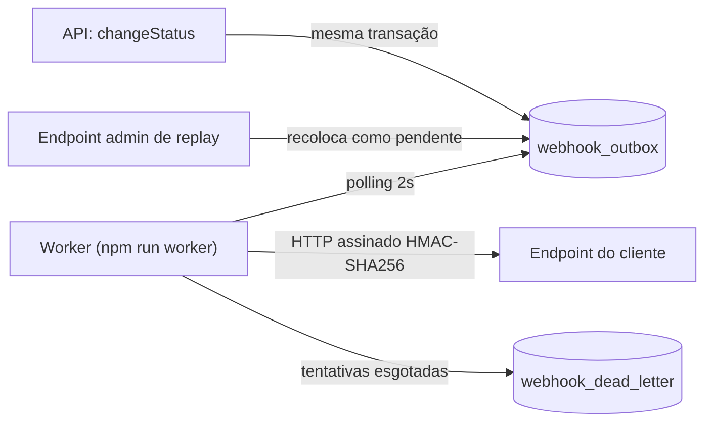

### RFC: Webhooks de notificação de mudança de status de pedidos

Autor: Larissa (Tech Lead), responsável por abrir o doc de design da feature ([09:50] Larissa)
Status: rascunho
Data: quinta-feira, 09:00 (data de calendário não informada na transcrição)
Revisores: Larissa (Tech Lead), Marcos (Product Manager), Bruno (Engenheiro Pleno, time de Pedidos), Diego (Engenheiro Sênior, time de Plataforma), Sofia (Engenheira de Segurança)

---

### 1. Resumo executivo
Clientes B2B precisam ser notificados de mudanças de status de pedidos em menos de 10 segundos, mas hoje só conseguem consultar `GET /orders` periodicamente ([09:00] Marcos; [09:02] Marcos). A proposta registra cada evento em uma outbox no MySQL, na mesma transação de `changeStatus`, e o entrega por um worker em processo separado, com polling de 2 segundos, retry com backoff, DLQ, assinatura HMAC-SHA256 e garantia at-least-once. Espera-se dos revisores a validação da arquitetura consolidada nas ADR-001 a ADR-008 e a resolução das questões em aberto da seção 5 antes do início da implementação ([09:50] Larissa).

---

### 2. Contexto e problema
Hoje a plataforma não emite eventos: a integração dos clientes depende de consultas periódicas a `GET /orders`, o que torna a integração lenta e cara para eles ([09:00] Marcos). O código atual não possui módulo de webhooks; os módulos existentes ficam em `src/modules/` (`auth`, `customers`, `orders`, `products`, `users`).

A mudança de status acontece em `changeStatus` (`src/modules/orders/order.service.ts`), cuja transação já atualiza a order, insere em `order_status_history` e movimenta o estoque dos produtos do pedido ([09:04] Bruno; `src/modules/orders/order.status.ts`). Acrescentar uma chamada HTTP ao cliente nessa transação faria um cliente lento travar mudanças de status de outros pedidos, e não haveria como reverter a mudança de status quando o cliente estivesse fora do ar ([09:04] Bruno).

A limitação técnica a resolver é, portanto, notificar clientes externos em menos de 10 segundos ([09:02] Marcos) sem acoplar a mudança de status à disponibilidade do cliente e sem perder eventos ([09:06] Diego). O escopo é apenas de saída, da plataforma para os clientes ([09:02] Marcos; [09:03] Sofia).

---

### 3. Proposta técnica

**Visão geral**
Adotar o padrão outbox no MySQL existente: ao mudar o status, a mesma transação SQL insere o evento em uma tabela `webhook_outbox`, garantindo que o evento existe se a transação commitou e desaparece se ela deu rollback ([09:06] Diego). Um worker separado lê a outbox e dispara as chamadas HTTP ([09:06] Diego). A abordagem resolve o problema porque retira a chamada HTTP da transação de `changeStatus`, não exige nova infraestrutura para um time pequeno ([09:07] Diego) e atende ao requisito de latência com polling de 2 segundos ([09:09] Diego; [09:10] Marcos).

**Componentes**
- `webhook_outbox`: tabela de eventos com status pendente, processando, falhou e entregue, indexada por status e `created_at` ([09:08] Diego), com id UUID ([09:51] Larissa) e payload já renderizado na inserção ([09:52] Larissa) (ADR-001, ADR-008).
- `changeStatus` em `src/modules/orders/order.service.ts`: passa a inserir o evento na outbox dentro da própria transação; se a inserção falhar, a mudança de status sofre rollback ([09:40] Bruno; [09:41] Diego) (ADR-001).
- Configuração de webhook: armazena url, secret, `customer_id`, estado ativo ([09:21] Bruno; [09:21] Sofia) e a lista de status que o endpoint quer receber ([09:33] Marcos).
- Worker de webhooks: processo Node separado, com entry-point `src/worker.ts`, script `npm run worker` e instância própria de `PrismaClient` sobre a mesma `DATABASE_URL` ([09:11] Larissa; [09:30] Bruno), que faz polling a cada 2 segundos dos eventos pendentes mais antigos ([09:09] Diego) (ADR-002, ADR-003).
- Política de retry: 5 tentativas com backoff de 1m, 5m, 30m, 2h e 12h ([09:17] Diego; [09:17] Larissa) (ADR-004).
- `webhook_dead_letter`: tabela separada para falhas permanentes, com payload, motivo da falha e timestamp, reprocessável manualmente por endpoint admin ([09:18] Diego) (ADR-005).
- Assinatura: HMAC-SHA256 sobre o corpo do request, enviada em `X-Signature`, com secret única por endpoint e rotação com grace period de 24 horas ([09:20] Sofia; [09:21] Sofia; [09:22] Sofia) (ADR-006).
- Identificador de evento: UUID gerado na entrada da outbox e enviado em `X-Event-Id`, base da garantia at-least-once ([09:25] Diego) (ADR-007).
- Módulo `src/modules/webhooks`: segue o padrão de controller, service, repository, routes e schemas, reaproveitando `AppError`, Pino e o middleware de erro centralizado ([09:27] Bruno; [09:30] Larissa).

**Interação entre os componentes**
1. `changeStatus` muda o status e, na mesma transação, registra o evento na `webhook_outbox` com o payload já renderizado ([09:06] Diego; [09:52] Larissa).
2. A cada 2 segundos, o worker busca em batch pequeno os eventos pendentes mais antigos ([09:08] Diego; [09:09] Diego).
3. O worker assina o corpo com a secret do endpoint e envia o evento com `X-Event-Id` e `X-Signature` ([09:20] Sofia; [09:44] Diego). Em caso de sucesso, o evento é marcado como entregue ([09:08] Diego).
4. Em caso de falha, o envio é retentado conforme o backoff; ao esgotar as tentativas, o evento vai para a `webhook_dead_letter` ([09:15] Diego; [09:17] Larissa).
5. Um replay manual pelo endpoint admin recoloca o evento da DLQ na outbox como pendente ([09:18] Diego).

Contratos de endpoints, formato de payload, headers completos, códigos de erro e regras de filtro ficam no FDD.

**Diagramas** (opcional)

---

### 4. Alternativas consideradas

### Disparo síncrono no service de orders

- **Descrição:** fazer a chamada HTTP ao cliente dentro do service de orders, no momento da mudança de status ([09:03] Larissa).
- **Trade-off que levou ao descarte:** dispensaria a outbox e o worker, mas um cliente lento travaria mudanças de status de outros pedidos e não haveria como reverter a mudança quando o cliente estivesse fora do ar ([09:04] Bruno); "Síncrono está fora de questão" ([09:06] Diego). Detalhes em ADR-001.

### Redis Streams ou similar

- **Descrição:** usar Redis Streams ou algo parecido no lugar de uma tabela no MySQL ([09:07] Larissa).
- **Trade-off que levou ao descarte:** exigiria subir mais infraestrutura ([09:07] Larissa), e para um time pequeno subir Redis Cluster para isso é overengineering, já que a outbox no MySQL existente resolve ([09:07] Diego). Detalhes em ADR-001.

### Trigger do banco para notificar o worker

- **Descrição:** usar trigger do banco para tornar a leitura da outbox mais reativa que o polling ([09:09] Bruno).
- **Trade-off que levou ao descarte:** ganharia reatividade, mas o MySQL não tem listener nativo e a trigger só executa SQL; avisar o worker exigiria improvisar algo como escrever em arquivo ou bater em um endpoint, o que "fica esquisito", enquanto o polling de 2 segundos já atende ao requisito ([09:09] Diego). Detalhes em ADR-002.

### Garantia exactly-once

- **Descrição:** garantir que cada evento seja recebido exatamente uma vez ([09:25] Diego).
- **Trade-off que levou ao descarte:** evitaria transferir a deduplicação para o cliente ([09:25] Sofia), mas exigiria coordenação dos dois lados e fica muito mais complexo, enquanto at-least-once com `X-Event-Id` resolve 99% dos casos ([09:25] Diego). Detalhes em ADR-007.

As demais alternativas descartadas (worker no processo da API, 3 tentativas, retry indefinido, DLQ como "failed" na outbox, secret global e renderização do payload no envio) estão registradas nas ADR-003 a ADR-008.

---

### 5. Questões em aberto

### Rate limiting de envio para o cliente

- **Situação:** adiada
- **Ponto levantado:** um cliente com 50 pedidos mudando de status em um minuto receberia 50 chamadas; a reunião decidiu não incluir rate limiting no escopo, observar e implementar se virar problema ([09:38] Diego; [09:39] Diego; [09:39] Larissa; [09:48] Larissa).
- **Responsável:** não definido na reunião; ponto levantado por Diego ([09:38] Diego).

### Escala para múltiplos workers e ordenação

- **Situação:** adiada
- **Ponto levantado:** a ordem de entrega vale só por `order_id` e enquanto houver um único worker; com múltiplos workers em paralelo a garantia se perde, e particionar por `order_id` ou usar lock pessimista foi tratado como "problema do futuro" ([09:12] Diego; [09:13] Diego; [09:13] Larissa).
- **Responsável:** não definido na reunião.

### Contagem das 5 tentativas

- **Situação:** não decidida
- **Ponto levantado:** não foi dito se as 5 tentativas incluem o envio inicial, embora a progressão de backoff tenha 5 intervalos ([09:17] Diego; [09:17] Larissa). Ver ADR-004.
- **Responsável:** não definido na reunião.

### Papel do status "falhou" da outbox ao lado da DLQ

- **Situação:** não decidida
- **Ponto levantado:** a outbox foi descrita com o status "falhou" ([09:08] Diego), e a falha permanente vai para a `webhook_dead_letter` ([09:18] Diego); o papel do status "falhou" nesse cenário não foi definido. Ver ADR-005.
- **Responsável:** não definido na reunião.

### Armazenamento da secret e assinatura durante o grace period

- **Situação:** não decidida
- **Ponto levantado:** a reunião definiu secret por endpoint e validade paralela de 24 horas na rotação ([09:21] Sofia), mas não definiu como a secret é armazenada nem qual secret assina os envios durante o grace period. Ver ADR-006.
- **Responsável:** não definido na reunião; HMAC e geração de secret passam pela revisão de segurança de Sofia ([09:46] Sofia).

---

### 6. Impacto e riscos

**Impacto**
- `changeStatus` (`src/modules/orders/order.service.ts`): passa a gravar na `webhook_outbox` dentro da transação; uma falha nessa inserção desfaz a mudança de status ([09:40] Bruno; [09:41] Diego).
- Operação: um novo processo, iniciado por `npm run worker`, passa a rodar separado da API ([09:11] Diego; [09:11] Larissa).
- Banco MySQL: novas tabelas de outbox, dead letter e configuração de webhook ([09:06] Diego; [09:18] Diego; [09:21] Bruno); o arquivamento de linhas entregues fica fora do escopo ([09:08] Diego).
- Clientes: precisam deduplicar por `X-Event-Id` e verificar a assinatura HMAC; Marcos documentará isso e a forma de integração no portal de desenvolvedor ([09:20] Sofia; [09:26] Marcos; [09:40] Marcos).
- Cronograma: três sprints, com ao menos dois dias úteis reservados para a revisão de segurança de Sofia antes do deploy ([09:46] Sofia; [09:47] Larissa); a Atlas quer a entrega para o fim de novembro ([09:45] Marcos).

**Riscos**

| Risco | Probabilidade | Impacto | Mitigação |
| --- | --- | --- | --- |
| Falha na inserção da outbox bloquear a mudança de status ([09:40] Bruno) | não avaliada na reunião | não avaliado na reunião | Aceito como trade-off para nunca haver status alterado sem evento ([09:41] Diego) |
| Acúmulo de eventos deixar o worker lento ([09:07] Bruno) | não avaliada na reunião | não avaliado na reunião | Índices em status e `created_at`, leitura só de pendentes em batch pequeno e arquivamento posterior ([09:08] Diego) |
| Cliente receber o mesmo evento mais de uma vez ([09:24] Diego) | não avaliada na reunião | não avaliado na reunião | `X-Event-Id` para deduplicação e destaque no portal de desenvolvedor ([09:25] Diego; [09:26] Marcos) |
| Cliente indisponível além da janela de quase 15 horas ([09:17] Diego) | não avaliada na reunião | aceito pelo produto ([09:17] Marcos) | Evento preservado na DLQ e replay manual pelo endpoint admin ([09:18] Diego) |
| Cliente lento não responder ao envio ([09:42] Diego) | não avaliada na reunião | não avaliado na reunião | Timeout de 10 segundos, tratado como falha e marcado para retry ([09:42] Diego) |
| Vazamento de secret pelo cliente, como já ocorreu ([09:22] Diego) | não avaliada na reunião | não avaliado na reunião | Secret por endpoint e rotação com grace period de 24 horas ([09:21] Sofia) |
| Perda de ordenação ao escalar para múltiplos workers ([09:12] Diego) | não avaliada na reunião | clientes não pediram ordenação global ([09:14] Marcos) | Manter single-worker por enquanto ([09:12] Diego) |
| Não entregar até o fim de novembro, com risco de a Atlas migrar para o concorrente ([09:00] Marcos; [09:45] Marcos) | não avaliada na reunião | não avaliado na reunião | Estimativa de três sprints com a revisão de segurança incluída ([09:47] Larissa) |

---

### 7. Decisões relacionadas

- [ADR-001: Registrar eventos de webhook com outbox no MySQL, na mesma transação da mudança de status](adrs/ADR-001-outbox-no-mysql.md): registro atômico do evento junto com a mudança de status.
- [ADR-002: Ler a outbox com worker em polling a cada 2 segundos](adrs/ADR-002-worker-em-polling-de-2-segundos.md): forma de leitura da outbox e latência de entrega.
- [ADR-003: Executar o worker de webhooks em processo separado da API](adrs/ADR-003-worker-em-processo-separado.md): isolamento do worker em relação ao ciclo de vida da API.
- [ADR-004: Retentar entregas com backoff exponencial e teto de 5 tentativas](adrs/ADR-004-retry-com-backoff-exponencial.md): política de retry.
- [ADR-005: Persistir falhas permanentes na tabela separada webhook_dead_letter](adrs/ADR-005-dead-letter-em-tabela-separada.md): DLQ e reprocessamento manual.
- [ADR-006: Assinar webhooks com HMAC-SHA256 e secret rotacionável por endpoint](adrs/ADR-006-assinatura-hmac-sha256-por-endpoint.md): autenticidade e integridade das entregas.
- [ADR-007: Garantir entrega at-least-once com deduplicação por X-Event-Id no cliente](adrs/ADR-007-entrega-at-least-once-com-event-id.md): garantia de entrega e identificação de duplicatas.
- [ADR-008: Guardar na outbox o payload renderizado no momento da inserção](adrs/ADR-008-payload-snapshot-na-insercao.md): fidelidade do payload ao momento da mudança de status.
