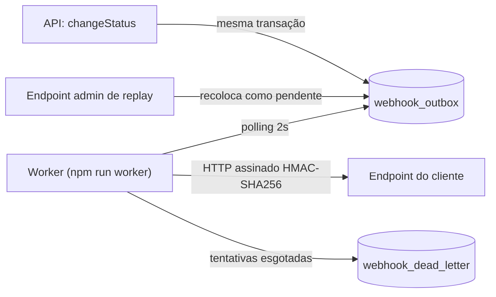

### RFC: Webhooks de notificação de mudança de status de pedidos

Autor: Larissa (Tech Lead)
Status: rascunho
Data: quinta-feira, 09:00 (data de calendário não informada na transcrição)
Revisores: Larissa (Tech Lead), Marcos (Product Manager), Bruno (Engenheiro Pleno, time de Pedidos), Diego (Engenheiro Sênior, time de Plataforma), Sofia (Engenheira de Segurança)

---

### 1. Resumo executivo (TL;DR)
Clientes B2B precisam ser notificados de mudanças de status de pedidos em menos de 10 segundos, mas hoje só conseguem consultar `GET /orders` periodicamente. A proposta registra cada evento em uma outbox no MySQL, na mesma transação de `changeStatus`, e o entrega por um worker em processo separado, com polling de 2 segundos, retry com backoff, DLQ, assinatura HMAC-SHA256 e garantia at-least-once. Espera-se dos revisores a validação da arquitetura consolidada nas ADR-001 a ADR-008 e a resolução das questões em aberto da seção 5 antes do início da implementação.

---

### 2. Contexto e problema
Hoje a plataforma não emite eventos: a integração dos clientes depende de consultas periódicas a `GET /orders`, o que torna a integração lenta e cara para eles. O código atual não possui módulo de webhooks; os módulos existentes ficam em `src/modules/` (`auth`, `customers`, `orders`, `products`, `users`).

A mudança de status acontece em `changeStatus` (`src/modules/orders/order.service.ts`), cuja transação já atualiza a order, insere em `order_status_history` e movimenta o estoque dos produtos do pedido, conforme as regras de `src/modules/orders/order.status.ts`. Acrescentar uma chamada HTTP ao cliente nessa transação faria um cliente lento travar mudanças de status de outros pedidos, e não haveria como reverter a mudança de status quando o cliente estivesse fora do ar.

A limitação técnica a resolver é, portanto, notificar clientes externos em menos de 10 segundos sem acoplar a mudança de status à disponibilidade do cliente e sem perder eventos. O escopo é apenas de saída, da plataforma para os clientes.

---

### 3. Proposta técnica

**Visão geral**
Adotar o padrão outbox no MySQL existente: ao mudar o status, a mesma transação SQL insere o evento em uma tabela `webhook_outbox`, garantindo que o evento existe se a transação commitou e desaparece se ela deu rollback. Um worker separado lê a outbox e dispara as chamadas HTTP. A abordagem resolve o problema porque retira a chamada HTTP da transação de `changeStatus`, não exige nova infraestrutura para um time pequeno e atende ao requisito de latência com polling de 2 segundos.

**Componentes**
- `webhook_outbox`: tabela de eventos com status pendente, processando, falhou e entregue, indexada por status e `created_at`, com id UUID e payload já renderizado na inserção (ADR-001, ADR-008).
- `changeStatus` em `src/modules/orders/order.service.ts`: passa a inserir o evento na outbox dentro da própria transação; se a inserção falhar, a mudança de status sofre rollback (ADR-001).
- Configuração de webhook: armazena url, secret, `customer_id`, estado ativo e a lista de status que o endpoint quer receber.
- Worker de webhooks: processo Node separado, com entry-point `src/worker.ts`, script `npm run worker` e instância própria de `PrismaClient` sobre a mesma `DATABASE_URL`, que faz polling a cada 2 segundos dos eventos pendentes mais antigos (ADR-002, ADR-003).
- Política de retry: 5 tentativas com backoff de 1m, 5m, 30m, 2h e 12h (ADR-004).
- `webhook_dead_letter`: tabela separada para falhas permanentes, com payload, motivo da falha e timestamp, reprocessável manualmente por endpoint admin (ADR-005).
- Assinatura: HMAC-SHA256 sobre o corpo do request, enviada em `X-Signature`, com secret única por endpoint e rotação com grace period de 24 horas (ADR-006).
- Identificador de evento: UUID gerado na entrada da outbox e enviado em `X-Event-Id`, base da garantia at-least-once (ADR-007).
- Módulo `src/modules/webhooks`: segue o padrão de controller, service, repository, routes e schemas, reaproveitando `AppError`, Pino e o middleware de erro centralizado.

**Interação entre os componentes**
1. `changeStatus` muda o status e, na mesma transação, registra o evento na `webhook_outbox` com o payload já renderizado.
2. A cada 2 segundos, o worker busca em batch pequeno os eventos pendentes mais antigos.
3. O worker assina o corpo com a secret do endpoint e envia o evento com `X-Event-Id` e `X-Signature`. Em caso de sucesso, o evento é marcado como entregue.
4. Em caso de falha, o envio é retentado conforme o backoff; ao esgotar as tentativas, o evento vai para a `webhook_dead_letter`.
5. Um replay manual pelo endpoint admin recoloca o evento da DLQ na outbox como pendente.

Contratos de endpoints, formato de payload, headers completos, códigos de erro e regras de filtro ficam no FDD.

**Diagramas** (opcional)

---

### 4. Alternativas consideradas

### Disparo síncrono no service de orders

- **Descrição:** fazer a chamada HTTP ao cliente dentro do service de orders, no momento da mudança de status.
- **Trade-off que levou ao descarte:** dispensaria a outbox e o worker, mas um cliente lento travaria mudanças de status de outros pedidos e não haveria como reverter a mudança quando o cliente estivesse fora do ar. Detalhes em ADR-001.

### Redis Streams ou similar

- **Descrição:** usar Redis Streams ou algo parecido no lugar de uma tabela no MySQL.
- **Trade-off que levou ao descarte:** exigiria subir mais infraestrutura, e para um time pequeno subir Redis Cluster para isso é overengineering, já que a outbox no MySQL existente resolve. Detalhes em ADR-001.

### Trigger do banco para notificar o worker

- **Descrição:** usar trigger do banco para tornar a leitura da outbox mais reativa que o polling.
- **Trade-off que levou ao descarte:** ganharia reatividade, mas o MySQL não tem listener nativo e a trigger só executa SQL; avisar o worker exigiria improvisar algo como escrever em arquivo ou bater em um endpoint, enquanto o polling de 2 segundos já atende ao requisito. Detalhes em ADR-002.

### Garantia exactly-once

- **Descrição:** garantir que cada evento seja recebido exatamente uma vez.
- **Trade-off que levou ao descarte:** evitaria transferir a deduplicação para o cliente, mas exigiria coordenação dos dois lados e fica muito mais complexo, enquanto at-least-once com `X-Event-Id` resolve 99% dos casos. Detalhes em ADR-007.

As demais alternativas descartadas (worker no processo da API, 3 tentativas, retry indefinido, DLQ como "failed" na outbox, secret global e renderização do payload no envio) estão registradas nas ADR-003 a ADR-008.

---

### 5. Questões em aberto

### Rate limiting de envio para o cliente

- **Situação:** adiada
- **Ponto levantado:** um cliente com 50 pedidos mudando de status em um minuto receberia 50 chamadas; a reunião decidiu não incluir rate limiting no escopo, observar e implementar se virar problema.
- **Responsável:** não definido na reunião; ponto levantado por Diego.

### Escala para múltiplos workers e ordenação

- **Situação:** adiada
- **Ponto levantado:** a ordem de entrega vale só por `order_id` e enquanto houver um único worker; com múltiplos workers em paralelo a garantia se perde, e particionar por `order_id` ou usar lock pessimista foi tratado como "problema do futuro".
- **Responsável:** não definido na reunião.

### Contagem das 5 tentativas

- **Situação:** não decidida
- **Ponto levantado:** não foi dito se as 5 tentativas incluem o envio inicial, embora a progressão de backoff tenha 5 intervalos. Ver ADR-004.
- **Responsável:** não definido na reunião.

### Papel do status "falhou" da outbox ao lado da DLQ

- **Situação:** não decidida
- **Ponto levantado:** a outbox foi descrita com o status "falhou", e a falha permanente vai para a `webhook_dead_letter`; o papel do status "falhou" nesse cenário não foi definido. Ver ADR-005.
- **Responsável:** não definido na reunião.

### Armazenamento da secret e assinatura durante o grace period

- **Situação:** não decidida
- **Ponto levantado:** a reunião definiu secret por endpoint e validade paralela de 24 horas na rotação, mas não definiu como a secret é armazenada nem qual secret assina os envios durante o grace period. Ver ADR-006.
- **Responsável:** não definido na reunião; HMAC e geração de secret passam pela revisão de segurança de Sofia.

### Forma de passar o `customer_id` na API de configuração

- **Situação:** não decidida
- **Ponto levantado:** o `customer_id` não vem do JWT e é passado "no body ou no path"; a escolha entre as duas formas não foi feita.
- **Responsável:** não definido na reunião.

### Identificador do evento no replay da DLQ

- **Situação:** não decidida
- **Ponto levantado:** o replay recoloca o evento na outbox como pendente, e o `X-Event-Id` é um UUID gerado quando o evento entra na outbox. Não foi definido se o replay preserva o `event_id` original ou gera um novo, o que afeta a deduplicação no cliente. Ver ADR-005 e ADR-007.
- **Responsável:** não definido na reunião.

### Granularidade da linha na outbox

- **Situação:** não decidida
- **Ponto levantado:** o filtro por lista de status é aplicado na inserção da outbox, e o envio leva o header `X-Webhook-Id`. Não foi definido se a outbox recebe uma linha por evento ou uma linha por webhook interessado quando o customer tem mais de um cadastro.
- **Responsável:** não definido na reunião.

### Momento da verificação do limite de 64KB

- **Situação:** não decidida
- **Ponto levantado:** o limite de 64KB foi decidido, com erro se ultrapassado, mas não o momento da verificação. Se for na inserção, dentro da transação de `changeStatus`, um payload acima do limite desfaz a mudança de status; se for no envio, o evento é recusado pelo worker.
- **Responsável:** não definido na reunião.

### Campos básicos da order no payload

- **Situação:** não decidida
- **Ponto levantado:** o payload inclui "os campos básicos da order", com `total_cents` citado como exemplo; a lista completa desses campos não foi definida.
- **Responsável:** não definido na reunião.

### Rota e formato do endpoint de rotação de secret

- **Situação:** não decidida
- **Ponto levantado:** foi decidido haver um endpoint para o cliente pedir nova secret pela API, mas não a rota, o método nem o formato da requisição e da resposta. Ver ADR-006.
- **Responsável:** não definido na reunião.

### Persistência do histórico de entregas

- **Situação:** não decidida
- **Ponto levantado:** o endpoint `GET /webhooks/:id/deliveries` deve mostrar sucesso ou falha, payload, response e tempo de resposta das entregas, mas não foi definido onde e como esses dados são gravados; as novas tabelas citadas são outbox, dead letter e configuração de webhook.
- **Responsável:** não definido na reunião.

### Código de erro para url não `https`

- **Situação:** não decidida
- **Ponto levantado:** a url `http` é recusada "com erro de validação" no schema Zod, e o código `WEBHOOK_INVALID_URL` foi listado para o módulo. Pelo middleware de validação atual (`src/middlewares/validate.middleware.ts`), um erro do schema Zod sai como `VALIDATION_ERROR`; não foi definido qual dos dois códigos o cliente recebe.
- **Responsável:** não definido na reunião.

### Situação do erro `WEBHOOK_SECRET_REQUIRED`

- **Situação:** não decidida
- **Ponto levantado:** o código `WEBHOOK_SECRET_REQUIRED` foi listado para o módulo, mas a secret é gerada pela plataforma e devolvida na criação; a situação em que esse erro ocorre não foi definida.
- **Responsável:** não definido na reunião.

### Critério de sucesso da entrega

- **Situação:** não decidida
- **Ponto levantado:** em caso de sucesso o evento é marcado como entregue, e a falta de resposta em 10 segundos é tratada como falha; não foi definido qual resposta do cliente (faixa de status HTTP) conta como sucesso.
- **Responsável:** não definido na reunião.

### Prazo de entrega para a Atlas

- **Situação:** não decidida
- **Ponto levantado:** a Atlas é citada primeiro com prazo "até fim do trimestre" e depois com prazo "pra fim de novembro". A estimativa de três sprints foi feita sobre o fim de novembro, e a divergência entre os dois prazos não foi esclarecida.
- **Responsável:** não definido na reunião; Marcos confirmaria o prazo com a Atlas.

---

### 6. Impacto e riscos

**Impacto**
- `changeStatus` (`src/modules/orders/order.service.ts`): passa a gravar na `webhook_outbox` dentro da transação; uma falha nessa inserção desfaz a mudança de status.
- Operação: um novo processo, iniciado por `npm run worker`, passa a rodar separado da API.
- Banco MySQL: novas tabelas de outbox, dead letter e configuração de webhook; o arquivamento de linhas entregues fica fora do escopo.
- Clientes: precisam deduplicar por `X-Event-Id` e verificar a assinatura HMAC; Marcos documentará isso e a forma de integração no portal de desenvolvedor.
- Cronograma: três sprints, com ao menos dois dias úteis reservados para a revisão de segurança de Sofia antes do deploy; a Atlas quer a entrega para o fim de novembro.

**Riscos**

| Risco | Probabilidade | Impacto | Mitigação |
| --- | --- | --- | --- |
| Falha na inserção da outbox bloquear a mudança de status | não avaliada na reunião | não avaliado na reunião | Aceito como trade-off para nunca haver status alterado sem evento |
| Acúmulo de eventos deixar o worker lento | não avaliada na reunião | não avaliado na reunião | Índices em status e `created_at`, leitura só de pendentes em batch pequeno e arquivamento posterior |
| Cliente receber o mesmo evento mais de uma vez | não avaliada na reunião | não avaliado na reunião | `X-Event-Id` para deduplicação e destaque no portal de desenvolvedor |
| Cliente indisponível além da janela de quase 15 horas | não avaliada na reunião | aceito pelo produto | Evento preservado na DLQ e replay manual pelo endpoint admin |
| Cliente lento não responder ao envio | não avaliada na reunião | não avaliado na reunião | Timeout de 10 segundos, tratado como falha e marcado para retry |
| Vazamento de secret pelo cliente, como já ocorreu | não avaliada na reunião | não avaliado na reunião | Secret por endpoint e rotação com grace period de 24 horas |
| Perda de ordenação ao escalar para múltiplos workers | não avaliada na reunião | clientes não pediram ordenação global | Manter single-worker por enquanto |
| Não entregar até o fim de novembro, com risco de a Atlas migrar para o concorrente | não avaliada na reunião | não avaliado na reunião | Estimativa de três sprints com a revisão de segurança incluída |

---

### 7. Decisões relacionadas

- [ADR-001: Registrar eventos de webhook com outbox no MySQL, na mesma transação da mudança de status](adrs/ADR-001-outbox-no-mysql.md): registro atômico do evento junto com a mudança de status.
- [ADR-002: Ler a outbox com worker em polling a cada 2 segundos](adrs/ADR-002-worker-em-polling-de-2-segundos.md): forma de leitura da outbox e latência de entrega.
- [ADR-003: Executar o worker de webhooks em processo separado da API](adrs/ADR-003-worker-em-processo-separado.md): isolamento do worker em relação ao ciclo de vida da API.
- [ADR-004: Retentar entregas com backoff exponencial e teto de 5 tentativas](adrs/ADR-004-retry-com-backoff-exponencial.md): política de retry.
- [ADR-005: Persistir falhas permanentes na tabela separada webhook_dead_letter](adrs/ADR-005-dead-letter-em-tabela-separada.md): DLQ e reprocessamento manual.
- [ADR-006: Assinar webhooks com HMAC-SHA256 e secret rotacionável por endpoint](adrs/ADR-006-assinatura-hmac-sha256-por-endpoint.md): autenticidade e integridade das entregas.
- [ADR-007: Garantir entrega at-least-once com deduplicação por X-Event-Id no cliente](adrs/ADR-007-entrega-at-least-once-com-event-id.md): garantia de entrega e identificação de duplicatas.
- [ADR-008: Guardar na outbox o payload renderizado no momento da inserção](adrs/ADR-008-payload-snapshot-na-insercao.md): fidelidade do payload ao momento da mudança de status.
